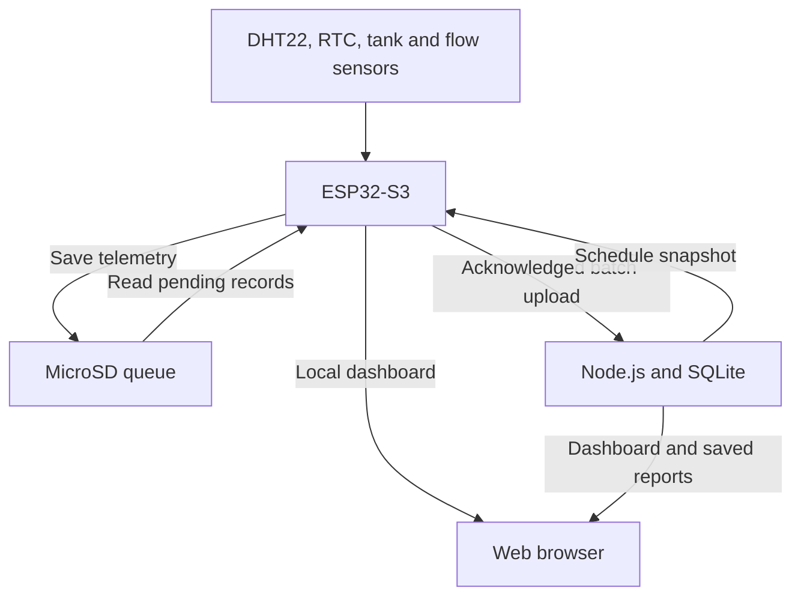

Internet of Swine (IoS) — Smart Swine Barn Environmental & Water Management System
An Internet of Things (IoT) system for swine barns that monitors temperature, humidity, heat stress, tank level and water flow, and supports scheduled cooling and bathing through an ESP32-S3 and a web dashboard.
This guide combines the original project documentation with the schedule and report repairs prepared on October 14, 2026. The setup and pin assignments below describe the corrected main.cpp, Node backend and dashboard. Features that still require implementation or hardware are identified under Current limitations.
Project objectives and features
1. Monitor temperature, humidity and heat stress
- Read temperature and relative humidity from a DHT22.
- Use a DS3231 RTC for timestamps and schedule evaluation.
- Calculate swine Temperature-Humidity Index (THI) using the same formula in the firmware, backend and dashboard:
  THI = 0.8 × T + (RH / 100) × (T − 14.4) + 46.4
  T is temperature in degrees Celsius; RH is relative humidity as a percentage.
- Show live measurements, gauges, environmental trends and configurable heat-stress classifications.
Default classification boundaries:
Classification	THI
Normal	Below 74
Stressful	74 through 78
Extreme Heat	Above 78 through 83
Danger Zone	Above 83

These classification boundaries are separate from the firmware's automatic cooling setpoint. The current firmware starts its THI cooling cycle at thiThreshold, which defaults to 85 and can be stored in device settings.
2. Monitor the water reservoir
- Measure tank level with the HC-SR04.
- Display tank fill percentage and supply status.
- Apply the firmware's minimum-water protection before energizing the misting or bathing relay. A failed tank measurement blocks those operations.
- Show dashboard alerts when tank level is below 20%.
3. Monitor water usage
- Measure instantaneous flow in liters per minute using the YF-S201B.
- Accumulate liters used from flow-sensor pulses. The current firmware counter is cumulative since boot.
- Provide a weekly water chart in the dashboard.
- Retain accurate daily totals and separate misting/bathing/cleaning consumption as implementation objectives; the current weekly aggregation and operation breakdown need further work.
4. Provide a web-based admin dashboard
- Prototype admin sign-in: admin / ios2024, with session preservation across page refreshes. ESP32 control authorization uses a separate device token.
- Schedule management: create, list, enable/pause and delete misting, bathing and cleaning schedules with start time, duration and selected days. Backend routes also support partial edits.
- Settings controls: temperature setpoint, THI classification boundaries, misting run duration and pause interval. The firmware also exposes its THI activation setpoint through /api/settings.
- Telemetry: temperature, humidity, THI, tank level, flow, cumulative water usage and system status.
- Alerts and diagnostics: heat stress, low water, sensor timeouts, invalid measurements and MicroSD status/synchronization details.
- Reports: environmental and activity logs, selectable 24h, 7d, 30d and All saved ranges, plus CSV export of the selected range from Node.
- Local operation: a Node-hosted dashboard on the LAN and an ESP32-hosted dashboard on its station IP or access point. External internet access is not required for local monitoring and stored schedule execution.
Repository structure
Path	Purpose
dashboard/index.html	Dashboard HTML and schedule/report interface
dashboard/css/base.css, layout.css, components.css, charts.css	Existing dashboard stylesheets
dashboard/js/config.js	Relative API URLs, host discovery, device-token handling and report-source discovery
dashboard/js/app.js	Login, navigation, interface controls and CSV downloads
dashboard/js/charts.js	SVG chart renderer, including empty and single-reading states
dashboard/js/data.js	Live state, polling and independent report-range data
dashboard/js/pages.js	Page rendering, diagnostics and report activity display
dashboard/js/schedule.js	Schedule requests, lists, day picker and modal validation
ios-backend/package.json	Backend dependencies and startup scripts
ios-backend/src/server.js	Express API and dashboard hosting
ios-backend/src/db.js	SQLite schema, migrations and data access
ios-backend/ios.db	Persistent backend database, created when absent
arduino/ios_sensor_node/ios-sensor-node/platformio.ini	PlatformIO board, libraries, filesystem and build configuration
arduino/ios_sensor_node/ios-sensor-node/src/main.cpp	ESP32-S3 monitoring, relays, schedules, local APIs and telemetry synchronization
arduino/ios_sensor_node/ios-sensor-node/src/secrets.h	Your Wi-Fi credentials, access-point password, device token and backend address

With the repository layout above, the PlatformIO project can use dashboard/ directly as its LittleFS image source. Keep the existing CSS, images and project dependency files when applying the repairs.
System architecture

Operation	Corrected behavior
DHT22 refresh	Every three seconds
Dashboard status polling	Every three seconds
Telemetry recording	Every 15 seconds, beginning with the first valid environmental reading
Backend schedule polling	Every ten seconds while the backend is reachable
Local history sampling	Every five minutes, plus the first valid sample after boot; saved immediately
Dashboard history/report refresh	Every 30 seconds, with immediate fetches on report-range changes
Backend health checks	Every 20 seconds, plus an initial check after connection

When SD is writable, each telemetry sample is queued there before upload. The ESP32 advances sync progress only after Node acknowledges the record IDs. Duplicate retries do not create duplicate imported readings. If SD is unavailable but Node is reachable, firmware attempts an acknowledged direct upload.
1. Run the Node backend
From the repository root:
cd ios-backend
npm install
npm start
Expected startup output includes:
[db] Using database: <full path to your ios.db>
IoS backend listening on http://0.0.0.0:3000
Open http://localhost:3000 on the laptop and sign in with admin / ios2024. From another device on the same reachable LAN, use http://<laptop-LAN-IP>:3000.
The default database path is ios-backend/ios.db, resolved relative to src/db.js. A new database receives default schedules and settings. Existing data is retained, with migrations applied as needed. Always check the printed path if records appear to be missing.
Optional environment variables:
Variable	Purpose
PORT	Backend listening port; default 3000
IOS_DB_PATH	Explicit database file path if your database is stored elsewhere
IOS_DASHBOARD_PATH	Explicit dashboard folder if your repository layout differs

Use the dependency manifest in ios-backend/ for backend installation. A root-level lockfile is not the backend's dependency manifest.
2. Dashboard API URLs and hosting modes
The default configuration is:
apiBase: ''
Relative requests such as /api/status contact the host that served the dashboard. Open the dashboard through Node or ESP32 HTTP hosting; avoid opening index.html through file://.
GET /api/info identifies the host:
- Node reports mode: "cloud"; this means the backend-hosted mode, which can still run entirely on a local laptop.
- ESP32 reports mode: "device", whether a device token is required and the configured backend URL.
When an ESP32-hosted page can reach the discovered Node backend, its reports use the SQLite archive. Otherwise it uses the ESP32's limited local history. Normal control requests remain directed to the host serving the dashboard.
The Token button stores the configured ESP32 access token in the browser. Enter the value of AUTH_TOKEN from your own secrets.h when device controls request authorization. Dashboard sign-in and the device token are separate.
3. Configure and upload firmware
Open the PlatformIO project at:
arduino/ios_sensor_node/ios-sensor-node/
The current firmware includes src/secrets.h. Keep your real settings there; the old SERVER_HOST / integer SERVER_PORT example does not match this firmware.
Example header with placeholders:
#pragma once

const char* WIFI_SSID = "YOUR_WIFI_NAME";
const char* WIFI_PASSWORD = "YOUR_WIFI_PASSWORD";
const char* AP_PASSWORD = "YOUR_AP_PASSWORD";
const char* AUTH_TOKEN = "YOUR_DEVICE_ACCESS_TOKEN";
const char* BACKEND_HOST = "YOUR_LAPTOP_LAN_IP";
const char* BACKEND_PORT = "3000";
Use an access-point password of at least eight characters. Set BACKEND_HOST to the laptop's current LAN IP. localhost would refer to the ESP32 itself. Keep secrets.h out of version control.
Keep the board, flash, partition and PSRAM settings appropriate to your ESP32-S3 DevKitC-1 N16R8 in the existing platformio.ini. The validation build used a generic ESP32-S3 configuration; it is not a replacement for your actual board configuration.
Build, upload and open Serial Monitor:
cd arduino/ios_sensor_node/ios-sensor-node
pio run
pio run -t upload
pio device monitor -b 115200
Firmware starts station Wi-Fi and the access point together. The access-point SSID is ESP32-Misting-System. Use the IP shown in Serial Monitor to open the device dashboard.
Check logs for:
- LittleFS mounted and any cached schedules/history loaded.
- MicroSD Ready, or a specific mount/write error.
- Backend connection status ONLINE or OFFLINE.
- Schedules: Cached ... backend schedule(s).
- MicroSD: Logged reading ... Pending sync: ...
- SYNC SUCCESS: Uploaded ... records. Remaining: ...
The current source prints status at 115200 baud. It does not implement the previously documented test pump, pump on, pump off, diag or other interactive Serial Monitor commands.
4. Upload the dashboard to LittleFS
Within the existing PlatformIO environment, confirm these settings for the repository layout above:
board_build.filesystem = littlefs
data_dir = ../../../dashboard
Then upload the filesystem image:
cd arduino/ios_sensor_node/ios-sensor-node
pio run -t uploadfs
Back up device-local schedules and history before uploading a new filesystem image. Rebuilding LittleFS can erase its JSON data files. The SQLite database on the laptop and the MicroSD log are separate.
After upload, the device serves index.html at http://<ESP32-IP>/. Local monitoring and cached schedules can operate while Node is unavailable, provided the ESP32 remains powered and the RTC has valid time.
5. Current hardware pin assignments
These assignments come from the corrected ESP32-S3 source:
Component	GPIO / interface	Purpose
DHT22 data	GPIO 4	Temperature and humidity
DS3231 SDA / SCL	GPIO 8 / GPIO 9	RTC over I²C
HC-SR04 TRIG / ECHO	GPIO 16 / GPIO 17	Tank distance measurement
YF-S201B signal	GPIO 5	Flow pulse interrupt
Misting relay	GPIO 18	THI cooling, mist schedules and device manual override
Bathing relay	GPIO 7	Bath schedules
Cleaning relay	GPIO 15	Cleaning schedules (active-LOW relay)
MicroSD CS	GPIO 10	SPI chip select
MicroSD MOSI	GPIO 11	SPI data to card
MicroSD SCK	GPIO 12	SPI clock
MicroSD MISO	GPIO 13	SPI data from card
Buzzer	Not configured	GPIO 18 is already assigned to the misting relay

Keep the HC-SR04 ECHO voltage divider from your existing wiring. The source uses TANK_EMPTY_CM = 14.0 and TANK_FULL_CM = 3.0; calibrate those measurements for the actual tank.
Relays are active LOW:
#define RELAY_ON LOW
#define RELAY_OFF HIGH
If your hardware needs active-HIGH behavior, adapt these definitions and the output initialization consistently. RELAY_ACTIVE_LOW is not the switch used by this source.
The pump test and manual control buttons can act directly through an ESP32-hosted dashboard, subject to water protection and run limits. Node exposes a command queue for those buttons, but this firmware does not poll /api/relay/command; Node-hosted button responses do not prove relay execution.
6. Schedule management and offline execution
Schedules contain a type (mist, bath or clean), label, local start time (HH:MM), duration, selected days and enabled state. The dashboard accepts whole-number durations from 1–60 minutes. Backend/device validation supports 1–1440 minutes through their APIs.
Both Node and firmware evaluate schedules in UTC+8; Node uses Asia/Manila. Midnight-crossing windows are supported. The RTC stores UTC internally and must have valid time for scheduled operation. An invalid detected RTC can recover from backend UTC time, or be set through the device's Set time control.
Schedule source	Storage and management
Node dashboard	SQLite schedules table; manage these schedules on Node
ESP32 dashboard	LittleFS /schedules.json; manage these schedules on ESP32
Backend cache on ESP32	/backend_schedules.json, refreshed every ten seconds; retained for offline execution

The cache does not overwrite standalone schedules or insert backend records into the ESP32's standalone CRUD list. Each source supports up to 20 schedules. The current engine chooses the first active schedule, with standalone schedules checked before backend schedules; simultaneous schedule types need further arbitration if all must run together.
Bath schedules drive GPIO 7 and cleaning schedules drive GPIO 15 when water protection allows operation.
7. Reports, persistence and shutdown behavior
Storage	What it retains
Node SQLite	Environmental readings, water readings, schedules, settings, diagnostics, activity and imported telemetry
MicroSD /ios/offline_readings.jsonl	Telemetry queued before upload, including when the backend is online
MicroSD /ios/sync_pos.json	Acknowledged synchronization progress
LittleFS /history.json	Up to 288 local chart samples; approximately 24 hours at five-minute spacing
LittleFS /activity.json	Up to 60 standalone activity events
Device NVS	Local device settings

On Node, Reports fetches the selected 24h, 7d, 30d or All saved range. CSV export includes the selected range's environmental records. The page queries stored data; it does not automatically create a separate report file. Click Export CSV to download one.
Local ESP32 reports support 24h and All saved within their limited buffer. Longer ranges require Node. Empty ranges display an explanation, and single-reading charts render a valid point.
To inspect saved reports after turning the ESP32 off, keep Node running and open the Node-hosted dashboard. The ESP32's web server and access point stop when power is removed. Already committed SQLite readings remain available. Pending SD records upload after the ESP32 powers up and reconnects; there are no new measurements while it is off.
If the RTC is invalid, firmware uptime is not treated as a Unix date. Node keeps the original value in offline_readings.source_ts_ms, stores rtc_valid and time_source, and dates the imported record by receipt time. Its exact offline capture date cannot be reconstructed from uptime alone.
Database snapshot inspected on October 14, 2026
The supplied ios.db contained 6,925 environmental readings, 12,204 water readings and eight schedules. Environmental readings were dated July 21 through October 2, 2026, with the latest at 2:35 PM in the Philippines. It contained zero imported offline_readings.
For that snapshot, an October 14 query for the last 24 hours or seven days correctly returns no environmental readings. All saved displays the older records. The running backend may use a different database file; check its printed path before concluding that data was lost.
8. Apply the schedule/report repair package
1. Stop Node and back up the project and database. Stop the backend before copying ios.db so a live WAL does not leave the backup incomplete.
2. Replace only the corresponding source files:
   Repair-package path	Repository destination
   ios-backend/src/server.js, db.js	ios-backend/src/
   dashboard/index.html	dashboard/index.html
   dashboard/js/*.js	dashboard/js/
   firmware/src/main.cpp	arduino/ios_sensor_node/ios-sensor-node/src/main.cpp
3. Keep your existing ios.db, CSS, images, secrets.h, dependency manifests and platformio.ini. The repair package does not contain a replacement database.
4. Confirm BACKEND_HOST and BACKEND_PORT, then restart Node and compile/upload the firmware. If needed, update the ESP32's dashboard filesystem image after backing up local JSON files.
5. Hard-refresh the browser with Ctrl+F5. Node's /api/info should report "mode":"cloud".
6. Open Node Reports → All saved, then add a Bath or Clean schedule and refresh the page to confirm persistence.
7. Check Serial Monitor for cached backend schedules and successful reading synchronization.
Repairs included
Fault in the previous files	Corrected behavior
Report polling always uses 24h; range buttons only redraw	Independent report data, actual range fetches and All saved
Empty results leave stale charts; one reading yields NaN coordinates	Clear empty states and valid single-reading points
ESP32 activity endpoint always returns []	Persistent local activity and imported telemetry activity on Node
Telemetry is tied to five-minute history sampling and delayed after reboot	Independent 15-second telemetry beginning with the first valid reading
Recent local history waits for a later flush; direct overwrite risks file loss	Immediate sample saves using a temporary file and recovery backup; failed saves remain pending
Uptime is imported as a date near 1970	Preserve original time, use receipt dating when RTC time is invalid
Failed batch transactions still return successful HTTP/JSON responses	HTTP 500 on transaction failure; firmware verifies exact acknowledged IDs
SD is used only after direct upload fails	Queue on writable SD before upload; acknowledge direct fallback when SD is unavailable
Firmware never fetches SQLite schedules	Backend snapshot endpoint and separate persistent cache
Schedule form closes after failures; flash errors return success	Retain form values, show HTTP errors and reject failed persistence
PATCH/PUT JSON handlers use a literal wildcard path	Supported prefix route for pause/edit requests
Node controls unnecessarily request a device token	Host discovery and token prompts when device authorization is required
Node schedule time depends on laptop timezone	UTC+8 schedule evaluation in Asia/Manila

9. Troubleshooting
Unable to add a Bath or Clean schedule
Both original Node create routes returned HTTP 201 in isolated tests with the supplied database. The user's live rejection was not reproduced there. Use the corrected form's visible response to identify the actual condition:
Response	Action
401	Enter the ESP32's configured AUTH_TOKEN; admin sign-in does not supply it
404	Check the host URL, /api/info, stale backend/firmware and cached JavaScript
400	Correct the displayed time, duration or selected-day error
507 on ESP32	Check the 20-schedule limit, LittleFS mount and available space
409 on Node	Remove an unused backend schedule to stay within the 20-record cache limit
500 / 503	Inspect the backend error and database path/permissions
Failed to fetch	Check that the host is reachable and running; open a served HTTP page

Reports are blank or readings appear missing
- Select All saved and check the latest stored date before assuming records were deleted.
- Confirm that startup prints the intended database path.
- Keep Node running and use its dashboard when the ESP32 is off.
- If pending SD records remain, verify backend reachability, the laptop's current LAN IP, Node's listening port and Windows Firewall access. Check Serial Monitor for the specific mount, upload or acknowledgement error.
- RTC-invalid records use receipt dates; check their stored time metadata if their capture date is uncertain.
10. API reference
Discovery, status and reports
Endpoint	Host	Purpose
GET /api/info	Node and ESP32	Hosting mode; ESP32 also supplies token requirement and backend URL
GET /api/health	Node	Backend availability and UTC time
GET /api/status	Node and ESP32	Measurements, system state, settings and diagnostics
GET /api/diagnostics	Node and ESP32	Latest available diagnostic information
GET /api/sd/status	Node and ESP32	MicroSD details and sync counters
GET /api/offline/status	Node and ESP32	Imported/queued telemetry status appropriate to the host
GET /api/readings/history?range=24h	Node and ESP32	Chart readings; Node also accepts 7d, 30d, all; ESP32 also accepts all
GET /api/reports/summary	Node and ESP32	Stored reading count, dates and supported ranges
GET /api/reports/export?range=24h	Node and ESP32	Environmental CSV; supported ranges match each host's report history
GET /api/activity?limit=30&range=24h	Node and ESP32	Activity records; local log is bounded
GET /api/water/weekly	Node and ESP32	Node weekly aggregation; ESP32 currently returns placeholder zeros

Ingest into Node
Endpoint	Payload / purpose
POST /api/readings/batch	Array of telemetry records with stable id, device time/RTC validity, measurements and pump state; current firmware upload path
POST /api/readings	Legacy environmental ingest: { temp, humidity, device_id }
POST /api/water	Legacy water ingest: { level_pct, used_l, flow_lpm, device_id }
POST /api/diagnostics	{ dht_ok, rtc_ok, tank_ok, flow_ok, relay_ok, sd_ok, details }
POST /api/relay/status	Legacy relay feedback: { relay_on, test_completed, flow_pulses, flow_lpm }

Batch responses contain ok, inserted, skipped, failed and accepted_ids. Failed transactions are not acknowledged as successful imports.
Schedules and settings
Endpoint	Host / purpose
GET /api/schedules?type=bath	Node and ESP32; also supports clean, mist
GET /api/schedules?type=all	Node; all types for the firmware cache
POST /api/schedules	Node and ESP32; { type, label, time, duration, days }
PATCH /api/schedules/:id	Node and ESP32; update supplied fields or { active }
PUT /api/schedules/:id	ESP32; additional update method
DELETE /api/schedules/:id	Node and ESP32; remove a schedule
GET /api/schedules/debug	Node; schedule evaluations and timezone details
GET/POST /api/settings/threshold	Node and ESP32; temperature setting, POST { value }
GET/POST /api/settings/durations	Node and ESP32; { mistDurationMin, mistPauseSec }
GET/POST /api/settings/thi	Node and ESP32; { normalMax, stressMax, extremeMax }
GET/POST /api/settings	ESP32; full device settings, including thiThreshold
POST /api/time	ESP32; { epoch } in UTC seconds

Relay/manual controls
Endpoint	Purpose and implementation status
POST /api/relay/test	{ duration_ms }; ESP32 applies a timed device override; Node queues a command
POST /api/relay/control	{ active }; ESP32 applies a device override; Node queues a command
POST /api/manual	ESP32 timed manual override, e.g. { active, duration_sec }
GET /api/relay/command	Node command queue; current firmware does not poll it

ESP32 control writes require its configured device token. The current Node API has no authentication middleware.
Current limitations
- Cleaning hardware: cleaning schedules drive GPIO 15 (active-LOW relay).
- Node relay controls: command polling is not implemented by this firmware. Test direct controls through the ESP32 host; a Node response is a queued request, not physical feedback.
- Settings synchronization: only backend schedules are fetched into the device cache. Node settings and ESP32 NVS settings remain separate. The local automatic cooling engine uses thiThreshold; the temperature slider alone is not its activation condition.
- Water accounting: the firmware volume resets at boot and has no daily reset. Node's weekly function sums cumulative readings, which can overcount consumption, while its operation breakdown fields remain zero. ESP32 weekly data is also a placeholder. Accurate daily/weekly and per-operation accounting needs interval-delta or session-based calculation.
- Overlapping schedules: the first active schedule wins; existing standalone schedules are evaluated first. Independent simultaneous mist/bath/clean operation requires additional arbitration.
- Diagnostics: flow and relay health flags currently include assumed values; they are not proof of a physical relay/flow self-test. Interactive serial test commands from older documentation are absent.
- Authentication: admin credentials are checked in frontend JavaScript, and Node API routes are unauthenticated. Keep the present deployment on a private LAN; public hosting needs server-side authentication and access controls.
- Power and timestamp recovery: unsynced SD records need the board to restart and reconnect. Uptime alone cannot recover exact offline capture dates.
Validation of the October 14 repairs
Passed: syntax checks for all eight JavaScript files; real Node/SQLite creation for Bath and Clean; report ranges and complete CSV export; duplicate replay; RTC-invalid import; transaction failure returning HTTP 500 without acknowledgements; reopening saved SQLite data; and DOM interaction checks for schedule creation, failed-save form retention, range changes, single/empty charts and CSV-link generation.
The delivered firmware compiled and linked successfully with PlatformIO espressif32 6.10.0, Arduino-ESP32 2.0.17, ESPAsyncWebServer 3.6.0, AsyncTCP 3.5.0, ArduinoJson 7.4.2, RTClib 2.1.4, Adafruit BusIO 1.17.4, DHT sensor library 1.4.6 and Adafruit Unified Sensor 1.1.15. The generic ESP32-S3 build used 71,028 bytes of static RAM and 1,013,981 bytes of firmware flash.
Validation used isolated database copies and placeholder build credentials. The original supplied database was preserved. Interface checks used a DOM runtime because stylesheets were not attached and a browser binary was unavailable. No physical relay, sensor, SD-card or power-cycle test was performed. Compile the source with your actual N16R8 configuration and verify operation on your hardware.